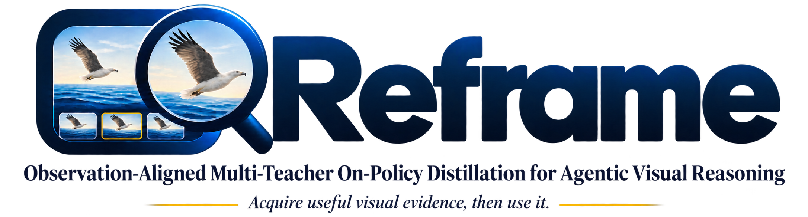
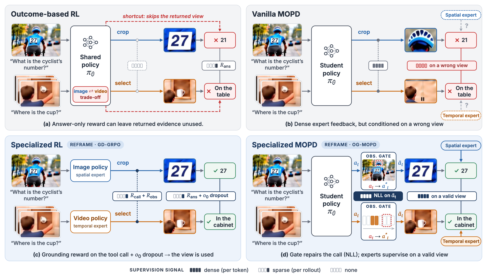

<p align="center">
  
</p>

<p align="center">
  <a href="https://scholar.google.com/citations?user=opMlNAMAAAAJ">Haozhi Yuan</a>,
  <a href="https://lihanddd.github.io/">Handong Li</a>,
  <a href="https://yfzhang114.github.io/">Yifan Zhang</a>,
  <a href="https://scholar.google.com/citations?user=ea5h-FcAAAAJ">Qianshan Wei</a>
</p>

<p align="center">
  <a href=""></a>
  <a href="https://huggingface.co/EliYuan00/Reframe"></a>
  <a href="https://huggingface.co/datasets/EliYuan00/Reframe-100K"></a>
</p>

<p align="center">
  <a href="#overview">Overview</a> · <a href="#results">Results</a> ·
  <a href="#quick-start">Quick Start</a> · <a href="#inference">Inference</a> ·
  <a href="#training-data">Data</a> · <a href="#training">Training</a> ·
  <a href="#evaluation">Evaluation</a>
</p>

## 🔥 News

- [2026.11] Code, dataset, and model weight are available.

<a id="overview"></a>

## 🌟 Overview

**Reframe: Observation-Aligned Multi-Teacher On-Policy Distillation for Agentic Visual Reasoning** is a two-stage training framework for image and video reasoning with visual tools, built on Qwen3.5-9B. Calling a tool is only useful when it returns relevant evidence and the model actually uses that evidence to answer. Reframe addresses both parts, then combines spatial and temporal specialists into one model.

<p align="center">
  
</p>

- **Learn to acquire and use evidence.** GroundDrop-GRPO (GD-GRPO) trains separate image and video specialists. Grounding rewards supervise their tool actions, while dropping the original visual input after a tool call encourages reasoning from the returned observation.
- **Consolidate specialists on useful observations.** Observation-Gated MOPD (OG-MOPD) learns from specialist feedback on student rollouts. During training, it repairs deficient tool actions using annotated evidence before continuing distillation, and teaches the student to produce the repaired actions itself.
- **Keep inference simple.** The model needs neither specialist teachers nor grounding annotations at inference. Only two tools are used.

This repo provides both RL and MOPD training stages, the shared tool implementation, and evaluation across 14 benchmarks. Reframe starts RL directly from the base model, without a task-specific SFT cold start.

<a id="results"></a>

## 📊 Results

The tables below report the experiments of Reframe. Image and video averages each cover seven benchmarks.

### Training paradigms

The Qwen3.5-9B base model is evaluated without tools.

| Model | Image Avg. | Video Avg. |
| --- | ---: | ---: |
| Qwen3.5-9B | 63.46 | 49.75 |
| Image-RL | 67.92 | 50.39 |
| Video-RL | 66.35 | 52.78 |
| Mix-RL | 66.75 | 51.41 |
| MOPD | 68.19 | 52.32 |
| Reframe | **69.48** | **53.10** |

Reframe improves over the base model by **6.02 points on images and 3.35 on videos**, and surpasses both specialists in their own modality. MOPD outperforms joint Mix-RL, and observation repair adds a further gain over vanilla MOPD.

### Existing agentic visual reasoning models

| Model | Image Avg. | Video Avg. | Observation dependence ↑ | Tool gain ↑ |
| --- | ---: | ---: | ---: | ---: |
| Pixel-Reasoner | 54.70 | 43.95 | 23.25 | +0.97 |
| Thyme | 57.77 | 44.24 | 34.20 | +1.47 |
| DeepEyes | 57.15 | 42.25 | 19.47 | +1.32 |
| DeepEyesV2 | 54.05 | 43.51 | 41.93 | −2.45 |
| Reframe | **69.48** | **53.10** | **75.53** | **+5.23** |

Reframe leads on **all 14 benchmarks** in this comparison. Observation dependence is measured on V* as 100 × (GT − (Random + Blank)/2) / (100 − (Random + Blank)/2): the share of errors under uninformative tool observations that are corrected once the ground-truth crop is returned.

<details>
<summary>Full results on all 14 benchmarks</summary>

| Benchmark | Pixel-Reasoner | Thyme | DeepEyes | DeepEyesV2 | Reframe |
| --- | ---: | ---: | ---: | ---: | ---: |
| V* | 81.68 | 81.68 | 83.25 | 81.68 | **91.62** |
| HR-Bench-4K | 72.50 | 77.13 | 74.63 | 71.00 | **84.75** |
| HR-Bench-8K | 65.88 | 67.88 | 67.50 | 61.38 | **83.50** |
| VisualProbe | 34.95 | 41.75 | 37.67 | 33.20 | **57.48** |
| ZoomBench | 40.47 | 46.51 | 46.75 | 41.30 | **59.88** |
| MME-RealWorld | 63.12 | 65.26 | 64.35 | 64.12 | **73.04** |
| PerceptionBench | 24.30 | 24.20 | 25.87 | 25.70 | **36.07** |
| Video-MME | 61.11 | 60.93 | 58.74 | 59.56 | **69.07** |
| Video-MME-v2 | 10.84 | 11.01 | 10.32 | 10.61 | **15.61** |
| MVBench | 62.82 | 61.92 | 59.16 | 59.63 | **69.11** |
| MLVU | 64.64 | 64.45 | 61.97 | 63.85 | **70.10** |
| MME-VideoOCR | 54.62 | 53.79 | 54.10 | 55.08 | **65.28** |
| VSI-Bench | 33.22 | 34.93 | 32.36 | 33.44 | **56.70** |
| V-STaR | 20.39 | 22.65 | 19.10 | 22.42 | **25.80** |

Video-MME-v2, VSI-Bench and V-STaR report Non-Lin Score, accuracy/MRA and 100 × mAM respectively; MLVU reports M-Avg.

</details>

<a id="quick-start"></a>

## 🚀 Quick Start

### Repository structure

```text
Reframe/
├── reframe/                 # Shared tools, rewards and swift integration
├── training/
│   ├── gd_grpo.sh           # Specialist RL
│   └── og_mopd.sh           # Specialist consolidation
├── inference/
│   └── run.py               # Example questions
├── evaluation/
│   └── run.py               # Benchmark preparation, evaluation and analysis
├── ms-swift/                # Training and inference framework
├── assets/                  # Teaser and logo
└── requirements.txt
```

### Setup

```bash
git clone https://github.com/EliYuan30/Reframe.git
cd Reframe
conda create -n reframe python=3.10 -y
conda activate reframe
uv pip install -r requirements.txt
```

### Inference

Download the model:

```bash
hf download EliYuan00/Reframe --type model --local-dir /path/to/your/model
```

Run an example question:

```bash
python inference/run.py \
  --model /path/to/your/model \
  --visual 1.png \
  --question "In the picture, what is the 2D relative position of the man in relation to the woman in black?"

python inference/run.py \
  --model /path/to/your/model \
  --visual 2.png \
  --question "SpaceX and TSM's stock prices, based on the slope of the trend line, which one shows a more pronounced upward or downward trend?"
```

### Training Data

[**Reframe-100K**](https://huggingface.co/datasets/EliYuan00/Reframe-100K) contains **99,726 image and video QA pairs**, with accepted answers, grounding evidence, and tool-applicability annotations.

Download the dataset:

```bash
hf download EliYuan00/Reframe-100K --type dataset --local-dir /path/to/your/dataset
```

Extract the media archives into the dataset directory:

```text
/path/to/your/dataset/
├── image.parquet    # 63,020 image qa
├── video.parquet    # 36,706 video qa
├── mix.parquet      # All 99,726 qa
├── images/
└── videos/
```

Both training stages use this directory. If the media are stored elsewhere, pass `--media-root` when training.

<details>
<summary>Data fields</summary>

| Column | Meaning |
| --- | --- |
| `qid` | Question ID |
| `question` | Question and options, if any |
| `answer` | Primary accepted answer |
| `extra_answer` | Other accepted answers, or `[]` |
| `image` | Image or frame paths |
| `is_video` | Is video flag |
| `tool_metadata` | Tool applicability and grounding annotations, stored as JSON |

</details>

### Training

By default, GD-GRPO uses GPUs 0–7; OG-MOPD uses GPUs 0–6 for the student and GPU 7 for the teachers.

#### Stage 1: GD-GRPO

Train the image specialist from Qwen3.5-9B:

```bash
bash training/gd_grpo.sh image \
  --model /path/to/your/base-model \
  --data-root /path/to/your/dataset \
  --output-dir /path/to/your/image-rl-model
```

Use `video` for the video specialist, with a separate output directory. Use `mix` for the Mix-RL.

#### Stage 2: OG-MOPD

Start from the student base model and use the two specialist checkpoints as teachers:

```bash
bash training/og_mopd.sh \
  --model /path/to/your/base-model \
  --image-teacher /path/to/your/image-rl-model/checkpoint-xxx \
  --video-teacher /path/to/your/video-rl-model/checkpoint-xxx \
  --data-root /path/to/your/dataset \
  --output-dir /path/to/your/reframe-model
```

Checkpoints and logs go to `--output-dir`. To resume, add `--resume /path/to/your/checkpoint`.

For multi-node training, add `--nodes N --node-rank R --master-addr HOST --master-port PORT` on each node, using shared model, data, and output paths.

### Evaluation

The evaluation suite covers seven image and seven video benchmarks:

| Modality | Benchmarks |
| --- | --- |
| Image | V*, HR-Bench 4K/8K, VisualProbe, ZoomBench, MME-RealWorld, PerceptionBench |
| Video | Video-MME, Video-MME-v2, MVBench, MLVU, MME-VideoOCR, VSI-Bench, V-STaR |

Prepare the downloaded benchmark datasets, then run evaluation:

```bash
python evaluation/run.py prepare --benchmark all \
  --data-root /path/to/your/raw-benchmarks \
  --output-dir /path/to/your/prepared-benchmarks

export LLM_JUDGE_API_KEY=your-api-key
python evaluation/run.py benchmark \
  --model /path/to/your/model \
  --data-root /path/to/your/prepared-benchmarks \
  --output-dir /path/to/your/evaluation-results \
  --gpus 0,1,2,3 \
  --judge-workers 4 \
  --videomme-v2-metadata /path/to/your/Video-MME-v2/test.parquet
```

Answers that strict matching cannot settle are judged by `gemini-3.1-flash-lite` through its OpenAI-compatible endpoint by default. To use another OpenAI-compatible provider, set `LLM_JUDGE_API_KEY`, `--judge-base-url https://your-api-provider/v1`, and `--judge-model your-model-name`. To use the native Gemini API instead, add `--judge-backend gemini`; it uses the same `LLM_JUDGE_API_KEY` and supports `--judge-thinking-level`.

Use `--benchmarks` to select benchmark and `--tool-mode w_tool|wo_tool|both` to choose the tool setting. Results are saved under `--output-dir/results/`. The `--videomme-v2-metadata` argument supplies the original Video-MME-v2 `test.parquet` for scoring.

For external models and observation-dependence evaluation, see:

```bash
python evaluation/run.py benchmark --help
python evaluation/run.py dependence --help
```
